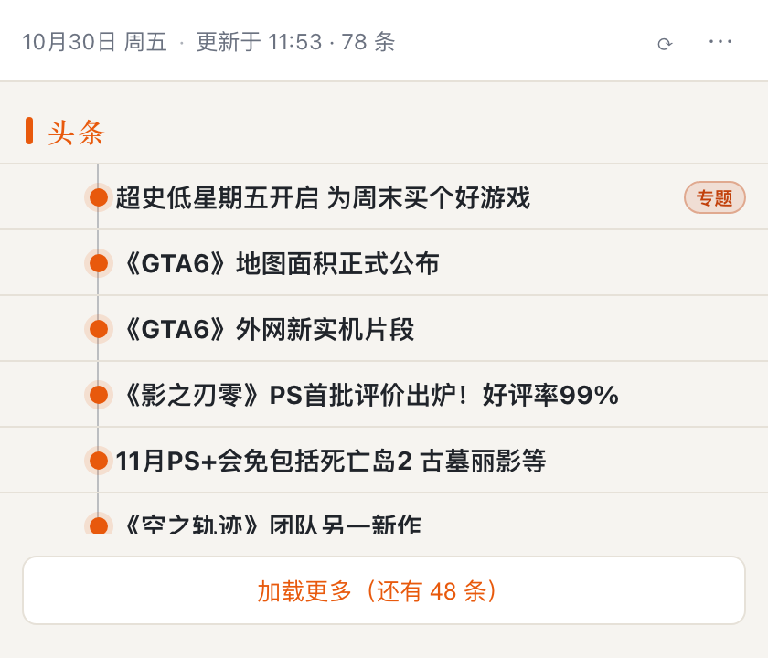

# 游民要闻（Gamersky Digest）

Chrome 侧边栏扩展：把游民星空（gamersky.com）首页的「今日要闻」搬进侧边栏，点开就能在插件内读正文，不必进站看广告和杂项。

[](https://github.com/yuyao110120/gamersky-digest/releases)
[](LICENSE)



## 功能

- 解析首页「今日要闻」：**6 条头条 + 3 页 × 24 条列表**（站点是服务端一次渲染，插件用「加载更多」逐页展开，不再发请求）
- 列表为**单行时间轴**：左侧是紧凑时间（`5m` / `2h` / `10-29`）+ 时间轴节点（未读橙色实心、已读灰色空心），中间标题超长省略、hover 自动滚动显示全文，右侧是专题/社区分类标签
- 「头条 / 今日要闻」分组标题滚动时**吸顶**，随时知道当前在看哪一组；不显示摘要，保持列表清爽
- 头条分组置顶、已读/未读、上次查看后的新条目分隔线
- 文章视图：标题、完整时间、来源、作者、正文；站内链接可点；图片默认占位、点击加载；视频显示外链入口；多页文章自动合并前 5 页
- 专题/活动页（`/zt/`、`/zhuanti/`，前端渲染）：点击标题**直接在新标签页打开原站**（保留 topicId 等参数）；游民圈子社区帖（`club.gamersky.com`）可直接内嵌阅读；JS 重定向壳页会提示并给原文入口
- 30 分钟后台刷新 + 图标 badge 显示新增条数；打开侧边栏清零
- 打开先渲染缓存，超过 10 分钟自动静默刷新；离线可读缓存列表和最近 30 篇文章
- 深浅色（跟随系统 / 手动）、正文字号三档；快捷键 Alt+G 打开侧边栏

## 下载与安装

**方式一：下载 Release（推荐）**

1. 到 [Releases](https://github.com/yuyao110120/gamersky-digest/releases) 下载最新的 `gamersky-digest-v*.zip` 并解压
2. 打开 `chrome://extensions`，右上角开启「开发者模式」
3. 点「加载已解压的扩展程序」，选择解压出来的 `gamersky-digest` 目录
4. 点工具栏的「游民要闻」图标（或按 Alt+G）打开侧边栏；首次打开会自动抓取，等 1–2 秒

**方式二：使用源码**

`git clone` 后，在 `chrome://extensions` 选择仓库根目录（含 `manifest.json`）加载。

要求 **Chrome 114+**（侧边栏 API）。不上架 Chrome Web Store，纯个人使用。

## 使用

- 刷新：右上角 ⟳；状态栏显示「更新于 HH:mm · N 条」
- 加载更多：列表底部按钮，逐页展开到 72 条列表
- 新内容：面板开着时后台抓到新内容，顶部出现「有 N 条更新 · 点击刷新」，不会打乱正在看的列表
- 读文章：点标题 → 正文视图；左上「‹ 返回」回列表（恢复滚动位置）；右上「原文 ↗」跳原站
- 菜单（⋯）：主题、正文字号、全部标为已读、打开游民星空
- 快捷键：Alt+G（macOS 上是 Option+G），可在 `chrome://extensions/shortcuts` 改

## 数据来源与抓取

- 列表：`https://www.gamersky.com/` 首页「今日要闻」模块（服务端渲染，HTML 里就有全部 3 页数据）
- 文章：直接请求文章页 HTML（/news/、/hardware/ 等 CMS 频道同模板；`club.gamersky.com` 社区帖单独适配 `.qzcmt-content` 结构）
- 全部请求由扩展自己发起（host_permissions），**不经过任何第三方服务器，不上传数据，不读 Cookie，不注入站点页面**
- 抓取频率：后台每 30 分钟一次；打开面板时若距上次成功超过 10 分钟再补一次；失败后 60 秒内重试一次
- 未使用：RSS（站点没有可用 RSS）、登录态、执行站点 JS

## 权限说明

| 权限 | 用途 |
| --- | --- |
| `sidePanel` | 侧边栏界面 |
| `alarms` | 30 分钟定时刷新 |
| `storage` | 本地缓存列表 / 已读 / 文章（约几百 KB） |
| `offscreen` | Service Worker 里没有 DOMParser，后台解析放在不可见的 offscreen 文档里 |

`host_permissions`：`https://www.gamersky.com/*`、`https://club.gamersky.com/*`（请求首页列表、文章页与社区帖）。

## 目录结构

```
manifest.json          MV3 清单
background.js         定时抓取 / offscreen 编排 / badge / 消息
offscreen.html|js     后台 DOMParser 宿主
sidepanel.html|css|js 侧边栏（列表 + 文章两视图）
lib/parser.js         纯函数解析器（首页 / 文章）
lib/fetcher.js        网络请求（超时、失败分类）
lib/store.js          chrome.storage 读写 + 纯合并/裁剪函数
lib/format.js         时间与文案格式化
icons/                像素风图标：logo.svg + 16/32/48/128 PNG（tools/make-logo.py 生成）
assets/favicon.ico    游民星空原始 favicon（图标生成源文件）
test/                 node --test 单测 + fixtures
tools/make-logo.py    从 favicon 生成像素 SVG + PNG 的脚本（纯标准库）
```

## 开发

- 依赖只为测试：`npm install`（jsdom）
- 跑测试：`npm test`
- 解析器 fixture 在 `test/fixtures/`（首页 / 文章 / 多页 / 重定向壳 / 动图 / 站内链接各一份）。站点改版后，抓一份新页面替换对应 fixture，跑测试即可定位选择器问题
- 图标：`python3 tools/make-logo.py`（读 `assets/favicon.ico`，生成 `icons/logo.svg` 与各尺寸 PNG，不需要第三方库）

## 已知限制

- 只做游民星空，不做其它站点
- 专题/活动页（`/zt/`、`/zhuanti/`，前端渲染）无法内嵌阅读，点击标题会直接打开原站；社区帖已支持内嵌阅读
- 部分条目是 JS 重定向壳页（如跳专题），阅读视图会提示
- 多页文章最多合并前 5 页，剩余给「打开原文」
- 图片默认不加载（省流量），点击才加载；动图取站点原图（会动，但通常较大，个别 5MB+）
- 时间按站点北京时间显示；跨时区时以文章页完整时间为准
- 站点改版会让选择器失效：连续失败 2 次黄色提示、5 次红色提示，并保留上次成功数据；此时需要更新 `lib/parser.js` 或 `test/fixtures`

## 排障

- 侧边栏空白/报错：打开 `chrome://extensions` →「游民要闻」→ 点「服务工作进程」看日志；侧边栏内右键「检查」看前端报错
- 后台解析日志：`chrome://extensions` → 游民要闻 → service worker 的 Console；offscreen 文档也会出现在扩展的检查视图里
- 清空数据：移除扩展重新加载，或在扩展页面执行 `chrome.storage.local.clear()`
- 问题反馈：[GitHub Issues](https://github.com/yuyao110120/gamersky-digest/issues)（请附 Chrome 版本、扩展版本、service worker 报错截图）

## 设计决策（为什么这么做）

- **侧边栏而非弹窗**：读全文需要高度，侧边栏常驻且不打断当前网页
- **无构建原生 MV3**：个人工具、依赖少、改完刷新即可
- **后台解析用 offscreen**：MV3 Service Worker 没有 DOM，用 `offscreen` 文档跑 DOMParser
- **解析集中在一个文件**：选择器失效时只改一处，fixture 单测兜底
- **图标来自站点 favicon**：解析游民星空的 16×16 ICO，去掉上世纪的 1px 灰色斜面边框，重绘为纯 `<rect>` 的像素风 SVG（`icons/logo.svg`，任意尺寸都清晰）；Chrome 清单图标不支持 SVG，所以再栅格化为 16/32/48/128 的 PNG
- **不静默失败**：保留上次数据 + 明确提示，避免「看起来正常其实是空的」

## 开源协议

本项目代码以 [MIT License](LICENSE) 开源。

- 游民星空的内容（新闻、图片、Logo 等）版权归游民星空所有；本项目仅作为**个人阅读用途**的客户端，不缓存分发内容、不用于商业用途。
- 扩展图标由游民星空 favicon 重绘而来，仅用于识别本工具；如涉版权问题，请在 [Issues](https://github.com/yuyao110120/gamersky-digest/issues) 提出，会立即移除。

## 版本

0.2.0 — 专题条目改为点击直接打开原站；支持游民圈子社区帖内嵌阅读

0.1.0 — 首个可用版本（对应 [Release v0.1.0](https://github.com/yuyao110120/gamersky-digest/releases/tag/v0.1.0)）
