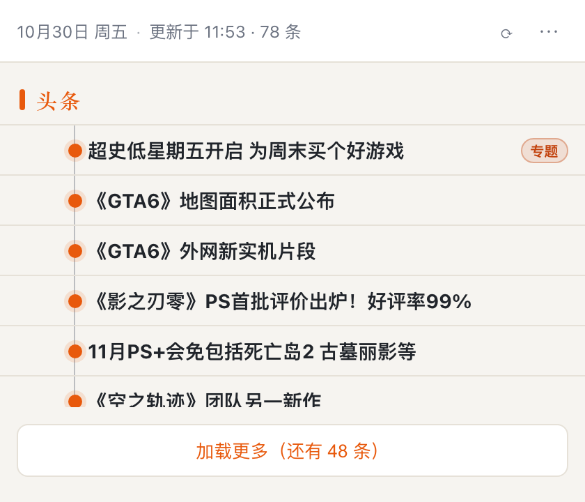

# 游民要闻（Gamersky Digest）

[](https://github.com/yuyao110120/gamersky-digest/releases)
[](LICENSE)

游民要闻是一个 Chrome 侧边栏扩展，用于在浏览器侧边栏中浏览游民星空（gamersky.com）首页的「今日要闻」，并可直接阅读资讯正文与社区帖子，无需进入站点页面。



## 功能

- 解析首页「今日要闻」模块：6 条头条与 3 页列表（每页 24 条），支持分页展开。
- 列表采用单行布局：左侧为发布时间与时间轴，中间为标题，右侧为内容类型标签（专题、社区）。
- 标题过长时省略显示，鼠标悬停时自动滚动展示全文；「头条」「今日要闻」分组标题在滚动时吸顶。
- 支持已读/未读状态，并在上次查看位置之后显示新条目分隔线。
- 支持站内阅读：解析标题、发布时间、来源、作者与正文；图片在点击后加载，动态图加载原图；视频提供原站链接；多页文章按每批 5 页加载。
- 社区帖子（`club.gamersky.com`）同样支持站内阅读。
- 专题/活动页面由前端脚本渲染，扩展无法读取其内容，点击标题会直接打开原站。
- 后台每 30 分钟刷新一次，通过扩展图标角标显示新增条目数量；打开侧边栏后角标清零。
- 支持离线查看已缓存列表与文章，提供浅色/深色主题、三档正文字号，以及 Alt+G 快捷键。

## 环境要求

- Chrome 114 或更高版本（需要 Side Panel API）。
- 不依赖构建工具，扩展以解压形式加载。

## 安装

### 从 Release 安装

1. 在 [Releases](https://github.com/yuyao110120/gamersky-digest/releases) 页面下载最新版本的 zip 包并解压。
2. 打开 `chrome://extensions`，启用右上角的「开发者模式」。
3. 点击「加载已解压的扩展程序」，选择解压后的 `gamersky-digest` 目录。
4. 点击工具栏中的「游民要闻」图标，或按 Alt+G 打开侧边栏。

### 从源码安装

克隆仓库后，在 `chrome://extensions` 中选择仓库根目录（包含 `manifest.json`）进行加载。

## 使用

- 刷新：点击右上角刷新按钮。状态栏显示最近一次更新时间和条目数量。
- 加载更多：列表底部的按钮可展开后续列表页。
- 阅读文章：点击标题进入正文视图；左上角「返回」回到列表并恢复滚动位置，右上角「原文」打开原站链接。
- 多页文章：首屏显示 5 页，正文底部提供「加载更多页」按钮，每次加载 5 页；全部加载完成后显示「已加载全部 N 页」。
- 新内容提示：侧边栏打开期间检测到新内容时，顶部显示「有 N 条更新」。点击后更新列表，不会打断当前浏览。
- 菜单：可切换主题与正文字号、全部标为已读、打开游民星空。
- 快捷键：Alt+G（macOS 为 Option+G），可在 `chrome://extensions/shortcuts` 中修改。

## 数据来源与实现

- 列表数据来自首页 https://www.gamersky.com/ 的「今日要闻」模块。该模块由服务端渲染，三页数据均包含在同一个 HTML 中。
- 文章数据直接请求文章页面 HTML，适用于 `/news/`、`/hardware/` 等使用统一模板的频道。
- 社区帖子来自 `club.gamersky.com`，使用独立的页面结构进行解析。
- 所有请求均由扩展直接发起，不经过第三方服务器，不上传数据，不读取站点 Cookie，也不在站点页面中注入脚本。
- 后台默认每 30 分钟刷新一次；打开侧边栏时如距上次成功刷新超过 10 分钟，会再刷新一次。刷新失败后 60 秒内重试一次。
- 不使用 RSS、登录状态或站点 JavaScript。

## 权限

| 权限 | 用途 |
| --- | --- |
| `sidePanel` | 提供侧边栏界面 |
| `alarms` | 定时刷新列表 |
| `storage` | 保存列表、已读状态与文章缓存 |
| `offscreen` | 在不可见的 offscreen 文档中解析 HTML（Service Worker 不提供 DOMParser） |

`host_permissions`：`https://www.gamersky.com/*`、`https://club.gamersky.com/*`，用于请求列表、文章与社区帖子。

## 存储

`chrome.storage.local` 中保存以下数据，均为有界缓存：

| 数据 | 说明 |
| --- | --- |
| 列表 | 每次刷新整体替换，约 80 条 |
| 已读记录 | 保留 7 天 |
| 文章缓存 | 最多 30 篇，保留 7 天，总大小不超过 3MB |
| 设置 | 主题与字号 |

`chrome.storage.local` 的配额为 10MB，上述数据总量通常不足 100KB。

## 隐私与内容版权

- 扩展不收集、不上传任何用户数据，不进行统计或追踪。
- 所有请求仅发往 gamersky.com 域名，不经过第三方服务。
- 游民星空的新闻、图片、Logo 等内容版权归游民星空所有。本项目仅用于个人阅读，不缓存分发内容，不用于商业用途。
- 扩展图标由游民星空 favicon 重绘，仅用于标识本工具；如涉版权问题，请通过 Issues 联系移除。

## 目录结构

```
manifest.json          扩展清单（MV3）
background.js          定时刷新、offscreen 调度、角标与消息
offscreen.html|js      后台 HTML 解析环境
sidepanel.html|css|js  侧边栏界面（列表与文章视图）
lib/parser.js          页面解析
lib/fetcher.js         网络请求
lib/store.js           chrome.storage 读写与缓存裁剪
lib/format.js          时间与文本格式化
icons/                 图标（SVG 与各尺寸 PNG）
assets/favicon.ico     图标生成使用的原始 favicon
test/                  单元测试与测试页面快照
tools/make-logo.py     图标生成脚本
```

## 开发

```bash
npm install   # 仅测试需要（jsdom）
npm test
```

- 解析测试使用 `test/fixtures/` 中的页面快照。站点改版后，可更新对应快照并运行测试以定位选择器问题。
- 图标由 `python3 tools/make-logo.py` 生成，读取 `assets/favicon.ico`，输出 SVG 与 PNG，仅使用 Python 标准库。

## 已知限制

- 仅支持游民星空。
- 专题/活动页面由前端渲染，无法在扩展内阅读，只能打开原站。
- 站点结构变更会导致解析失败。扩展会在连续失败时显示提示并保留上次成功的数据，此时需要更新解析逻辑或测试快照。
- 图片默认不加载以节省流量；动态图会加载原图，文件可能较大。
- 时间以站点所在时区（北京时间）显示。

## 版本

- 0.3.2 — 文章缓存增加总大小上限。
- 0.3.1 — 修复分页加载后已展开图片被重置、正文滚动位置丢失的问题。
- 0.3.0 — 多页文章支持分批加载。
- 0.2.0 — 专题条目改为直接打开原站；支持社区帖子阅读。
- 0.1.0 — 首个版本。

## 许可

本项目代码以 [MIT License](LICENSE) 开源。
